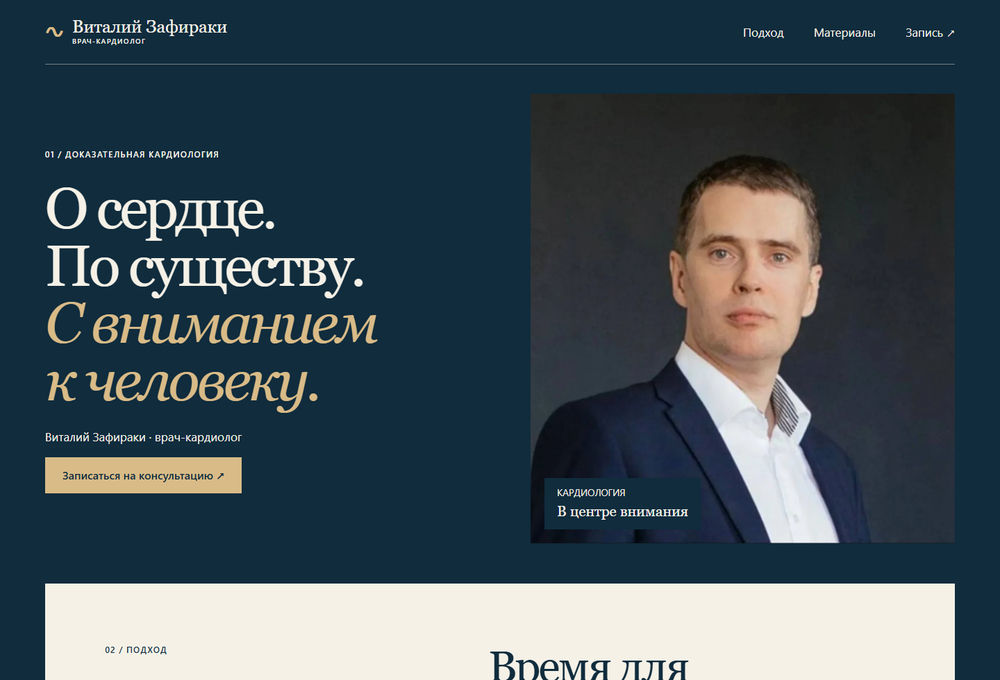
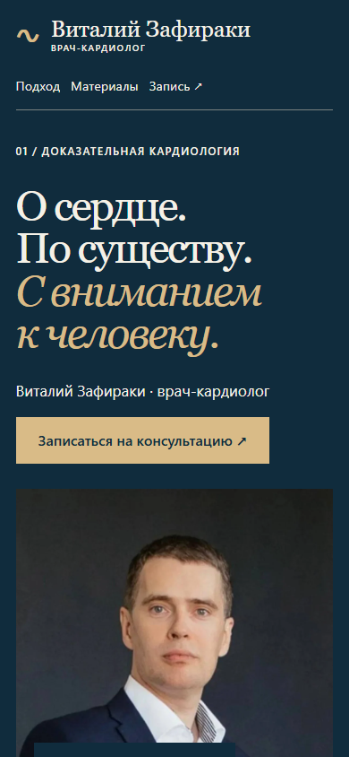

# Кардиолог · В центре внимания

[Открыть сайт](https://memorim.github.io/cardiologist-landing-designs/)

Посетитель оставляет контакт и время для связи. Владелец проекта получает заявки в закрытой таблице `appointment_requests` в Neon. Колонка `site` для этого сайта — `focus`. Колонка `handled` позволяет отмечать обработанные обращения. Форма подтверждает получение заявки после записи в PostgreSQL. Время визита согласуется отдельно.

[Квиз владельца](https://mrqz.me/6ae6cf059b4d2a000f864063) принимает ответы через кабинет Марквиз. Памятка к визиту доступна прямо на странице.

Сервис Render использует Node.js и переменную `DATABASE_URL`. Запуск: `pnpm install --frozen-lockfile`, затем `pnpm start`. При старте применяется [миграция](001_appointments.sql). В CI сценарий `pnpm test` проверяет оба сайта с PostgreSQL.

[Проверка опубликованной формы 07.11.2026](docs/LIVE_INTAKE_VERIFICATION.md).

[Бесплатные уведомления о заявках](docs/FREE_NOTIFICATIONS.md).
