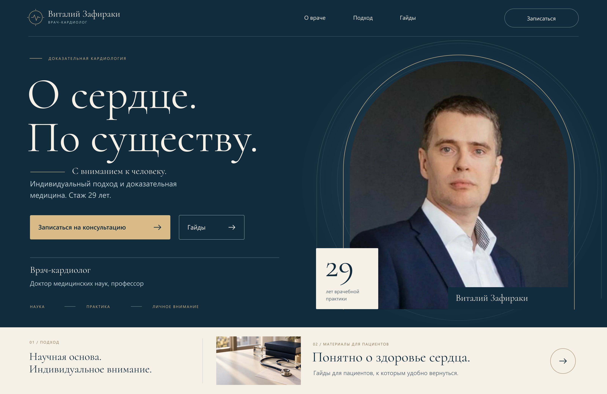

# Кардиолог — концепции первого экрана

Три визуальных направления сайта врача с отдельными компьютерными и мобильными композициями.

[Открыть проект](https://memorim.github.io/cardiologist-landing-designs/)




## Устройство проекта

HTML/CSS-галерея с PNG-превью и редактируемыми SVG-макетами. Сайт можно обслуживать статическим HTTP-сервером. Сборка приложения и настройка секретов не требуются.

## Локальный запуск и проверки

Python 3.12.14, как в CI.

```bash
python tests/check_assets.py
python .github/scripts/check_docs.py
python -m http.server 8080 --bind 127.0.0.1
```

Откройте `http://localhost:8080`. CI проверяет ссылки на файлы, наличие изображений и документацию. Макеты внутри PNG/SVG не становятся интерактивными от запуска галереи.

## Границы реализации

Галерея показывает дизайн; запись на приём и выдача материалов не подключены. Кнопки внутри изображений не являются рабочими формами.

База данных, миграции и API в текущем варианте не используются.

[Технические сведения](docs/TECHNICAL.md) · [Выполненные проверки](docs/VERIFICATION.md) · [История изменений](CHANGELOG.md)
